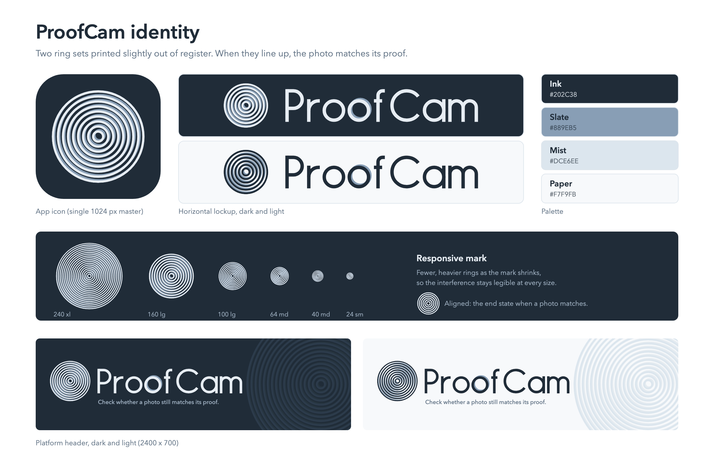

# ProofCam identity

## The idea

A photographer's proof needs two things to line up: the image and its signed record. The mark shows that as two sets of concentric rings printed slightly out of register. Where the sets drift apart they interfere and produce moiré fringes. When they line up, the pattern resolves into clean rings, which is what ProofCam shows when a photo matches its proof.

The wordmark carries the same idea in one place. In "ProofCam" only the second "o" is out of register, with a slate ring offset to the upper right, the same direction as the slate layer in the mark.

The mark is a lens, a ripple and a fingerprint at once. It does not use a camera, a lock, a shield or a checkmark.

## Files

| File | Use |
| --- | --- |
| `ios/AppIcon.appiconset` | Drag into `Assets.xcassets`. Single 1024 px opaque master; iOS applies its own corner mask. |
| `png/proofcam-app-icon-1024.png` | The same icon, for App Store Connect and the Congressional App Challenge cover art. |
| `png/proofcam-header-dark.png`, `-light.png` | Platform header, 2400 × 700. |
| `png/proofcam-logo-dark.png`, `-light.png` | Horizontal lockup on a solid background. |
| `png/proofcam-logo-*-transparent.png` | Lockup for placing on your own background. |
| `png/proofcam-mark-lg-*.png`, `proofcam-mark-aligned-*.png` | Mark only, transparent. |
| `svg/` | Vector sources for everything above, plus the `xl`, `lg`, `md` and `sm` mark sizes. |

The header SVGs use live text for the tagline (Avenir Next, falling back to a system sans). Use the PNG when the exact lettering matters.

## Colors

| Name | Hex | Role |
| --- | --- | --- |
| Ink | `#202C38` | Icon ground, text on light |
| Slate | `#889EB5` | Brand color, the back ring set |
| Mist | `#DCE6EE` | Quiet backgrounds |
| Paper | `#F7F9FB` | Light ground |

The front ring set is Mist-white (`#E7EDF3`) on dark and Ink on light. Slate is always the layer behind.

## Responsive mark

The mark changes ring count with size so the interference stays readable. Do not scale one version across every size.

| Tier | Rings | Use |
| --- | --- | --- |
| `xl` | 18 | Posters, covers, anything 240 px or larger |
| `lg` | 9 | App icon, headers, 60 to 240 px |
| `md` | 6 | Lockups, toolbars, 32 to 60 px |
| `sm` | 4 | Favicons, under 32 px |

## Using it

- **Clear space:** at least the width of one ring band on every side.
- **Minimum size:** the lockup should stay at least 120 px wide; the mark at least 20 px.
- **Don't:** recolor the rings, flatten the offset, rotate the mark, put it on a busy photo, or add a lock, shield or checkmark. Use the aligned mark only to show a match.
- **Meaning:** the aligned mark means a photo matched its proof. It is not a stamp of authenticity, and it must not appear next to a result that didn't match.

## Putting it in the app

1. **App icon.** In Xcode, open `Assets.xcassets`, delete the existing `AppIcon` if there is one, and drag `ios/AppIcon.appiconset` in. In the target's General tab, set App Icons Source to `AppIcon`.
2. **In-app mark.** The app currently draws a crosshair registration mark (`RegistrationMark` in `CameraScreen.swift`). To adopt this logo, replace it with a SwiftUI view that draws the two ring sets, or import `svg/proofcam-mark-md-*.svg` into the asset catalog as a vector image ("Preserve Vector Data"). Use the tier that matches the size.
3. **Header.** Use `png/proofcam-header-*.png` for a web or presentation header. In the app, build the header natively: the lockup on the left, with the large faint `xl` mark bleeding off the right edge.
4. **Motion.** The registration animation already in the app (`RegistrationAlignment`) maps directly onto this logo: the back ring set drifts while the app works, then settles into the front set on a match.
